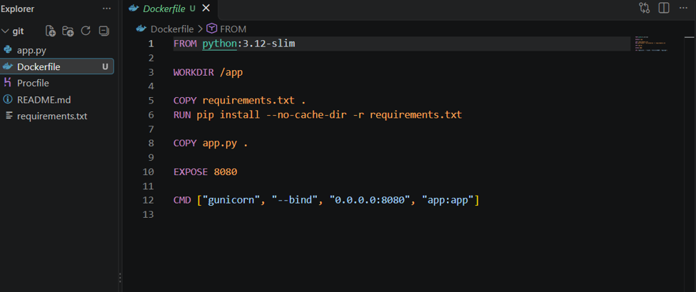
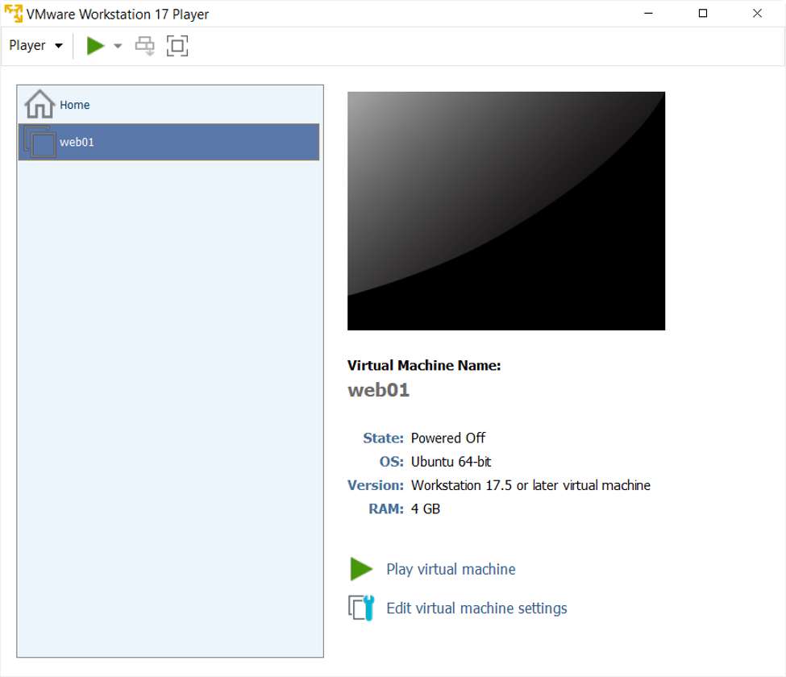
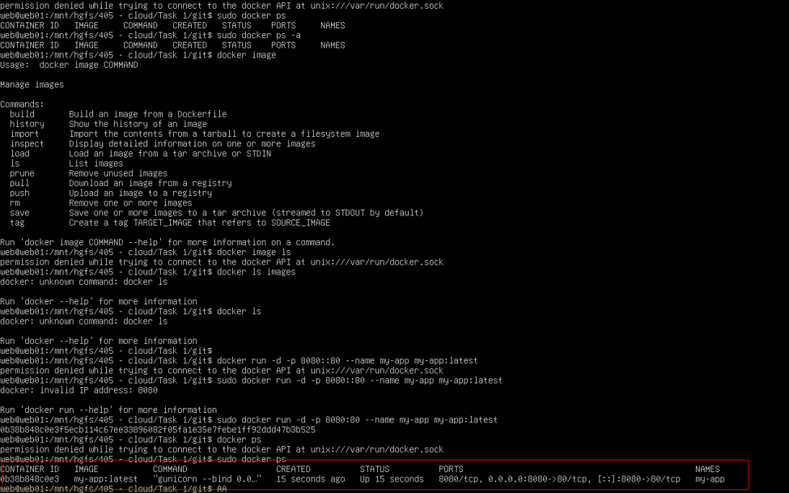

# Architecture Pack

## 1.1 Proposed Architecture

The proposed architecture uses managed cloud services for data ingestion, storage, processing and analytics. Sunbeam retains control of customer identity mapping, encryption keys, access policies and regulatory decisions within its Nigerian-controlled environment.

The architecture supports the three business decisions:

1. Monthly identification of feeders requiring revenue protection.
2. Feeder outage detection and alerting within fifteen minutes.
3. Daily verification of estimated bills and review of disconnection decisions.

**Table 1: Workload inventory**

| Workload | Load pattern | Data sensitivity | Service model | Reason |
|---|---|---|---|---|
| Meter data ingestion | Continuous, 15-minute readings | High | PaaS | Managed ingestion reduces infrastructure administration. |
| Data lake and storage | Daily batch and historical retention | High | PaaS | Scalable storage with encryption, lifecycle and backup management. |
| Data processing and quality checks | Nightly batch and streaming | High | PaaS | Managed processing supports reconciliation, validation and outage detection. |
| Analytics and loss prediction | Monthly model execution | High | PaaS | Managed analytics reduces the need to maintain servers and machine learning infrastructure. |
| Customer identity mapping and encryption keys | Occasional, controlled access | Very high | IaaS / controlled infrastructure | Retain direct control over identity re-identification and cryptographic assets in Nigeria. |
| Field revenue dashboard | Daily mobile access | High | PaaS | Managed application hosting supports secure access from mobile devices. |
| Workforce identity and access management | Continuous authentication | High | SaaS | Centralised authentication, MFA and role-based access control. |
| Billing review and dispute management | Daily, transaction-driven | Very high | PaaS | Provides auditable workflows and human approval for billing and disconnection reviews. |

**Table 2: Shared responsibility – readings pipeline**

| Responsibility | Sunbeam's responsibility | Cloud provider's responsibility |
|---|---|---|
| Infrastructure | Select services, configure capacity and approve architecture. | Maintain physical data centres, servers, networking and underlying infrastructure. |
| Data security | Define encryption requirements, access policies and data classification. | Provide encryption capabilities, infrastructure security and platform security controls. |
| Data management | Validate readings, reconcile meter mappings, manage retention and data quality. | Maintain storage availability, durability and managed service operations. |
| Identity and access | Manage user identities, permissions, MFA and access reviews. | Secure the underlying identity and platform services supplied. |
| Monitoring and recovery | Configure application monitoring, alerts, backups and recovery procedures. | Maintain service availability and infrastructure-level recovery capabilities. |
| Regulatory compliance | Ensure lawful processing, cross-border transfer compliance and customer rights. | Provide contractual security commitments, compliance documentation and relevant service certifications. |

**Important:** Using PaaS does not transfer responsibility for customer data protection or regulatory compliance to the provider. Sunbeam remains accountable for its decisions as the data controller.

## 1.2 Responsible-Use Brief

| Who could be harmed? | Where the system must refuse or escalate | Initial position |
|---|---|---|
| Unmetered customers | Estimated bills exceeding NERC-approved feeder caps must be flagged for correction. | Estimates must be justified, transparent and subject to applicable regulatory caps. |
| Customers suspected of tampering | Suspicion generated by analytics must not automatically result in disconnection or penalties. | A field investigation and authorised human review are required. |
| Customers in rural or low-income communities | Missing readings, delayed uploads or poor connectivity must not automatically increase a feeder's risk score. | Loss predictions must be checked for geographic and customer-group bias before operational use. |

## ADR-01: Service model for the readings pipeline

**Decision:** Adopt Platform as a Service (PaaS) for the meter readings pipeline.

**Context:** Sunbeam receives approximately 400,000 smart-meter readings across 1,000 feeders in its Standard production tier. Maintaining ingestion servers, storage infrastructure and processing clusters internally would create unnecessary operational overhead for a team of three engineers.

**Options considered:**

| Option | Assessment |
|---|---|
| IaaS | Provides flexibility but requires Sunbeam to manage operating systems, patching, scaling and infrastructure availability. |
| PaaS | Provides managed ingestion, storage and processing with reduced operational overhead. |
| SaaS | Offers limited control over the specialised data ingestion, reconciliation and processing requirements. |

**Rationale:** PaaS offers the best balance of scalability, operational simplicity, security controls and cost management. It also supports the fifteen-minute outage detection requirement through managed streaming and event-processing capabilities.

**Consequences:**

- Reduced infrastructure administration.
- Faster deployment and easier scaling.
- Dependence on cloud provider availability and service pricing.
- Potential vendor lock-in, mitigated through open data formats, documented interfaces and infrastructure-as-code.

## ADR-02: Workload retained on infrastructure Sunbeam controls

**Decision:** Retain the customer identity mapping service and associated re-identification keys within Sunbeam-controlled infrastructure in Nigeria.

**Context:** The existing platform replaces customer identities with codes before transferring meter readings to its South African data lake. The corresponding identity mapping key remains on a server in Abeokuta.

**Rationale:**

- Prevents direct customer identification from being readily available in the analytical environment.
- Maintains Sunbeam's direct control over customer identity mapping.
- Reduces unnecessary exposure of personal information to cloud-based analytical workloads.
- Supports the principle of data minimisation and controlled access.

**Security controls:**

- Restrict access to authorised personnel.
- Encrypt identity mapping records and keys at rest and in transit.
- Maintain access logs and regular access reviews.
- Separate identity mapping privileges from analytical platform privileges.
- Maintain encrypted backups and a documented recovery procedure.

**Consequences:** Sunbeam retains responsibility for securing, monitoring and recovering this infrastructure. The workload must remain deliberately small to avoid creating an unnecessary operational burden.

## 3. Regulatory and data protection considerations

The architecture will be designed around three requirements:

**NERC compliance**

- Apply the current approved estimated-billing energy caps for each feeder.
- Maintain evidence supporting estimated billing calculations.
- Record billing reviews, adjustments and customer disputes.
- Ensure disconnection decisions follow applicable NERC procedures and provide human review and appeal.

NERC has published guidance on estimated-billing caps and has taken enforcement action against distribution companies for non-compliance.

**Nigeria Data Protection Act 2023**

- Treat customer-linked meter readings as personal data.
- Document the lawful basis for each processing activity.
- Conduct a Data Protection Impact Assessment (DPIA) for the loss prediction and customer profiling activities.
- Apply data minimisation, encryption, access control and retention policies.
- Document the legal basis and safeguards for transferring personal data to South Africa.

**Governance:** The Data Protection Officer will oversee privacy compliance, while the engineering team implements the technical controls. The legal basis for predictive analytics must be documented and reviewed rather than assumed.

## 4. Initial deployment approach

The first deployment will establish the foundation without introducing unnecessary operational complexity.

| Deployment phase | Deliverable |
|---|---|
| 1. Foundation | Cloud account structure, networking, IAM, MFA and security policies. |
| 2. Data services | Managed ingestion, encrypted data lake and storage policies. |
| 3. Data protection | Pseudonymisation, controlled identity mapping and audit logging. |
| 4. Initial pipeline | Meter ingestion, reconciliation and data quality validation. |
| 5. Monitoring | Pipeline health, storage consumption, failed jobs and service availability monitoring. |

**Initial acceptance criteria:**

- Meter readings can be securely ingested and stored.
- Customer identities are not exposed to general analytics users.
- Data quality checks identify duplicate, delayed and incorrectly mapped readings.
- Infrastructure and data access activities are auditable.
- The deployment can be operated by the existing three-person engineering team.

 
 

 

 

