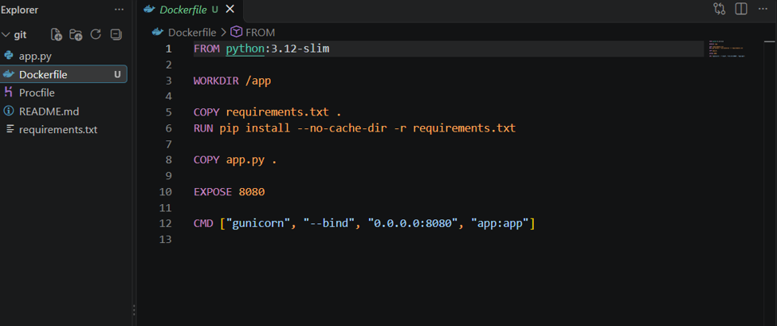
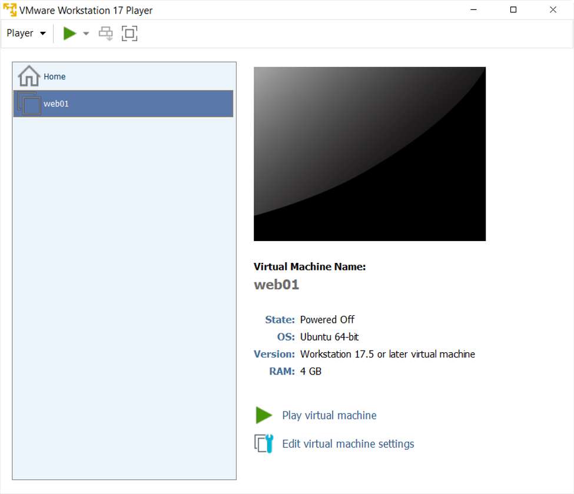
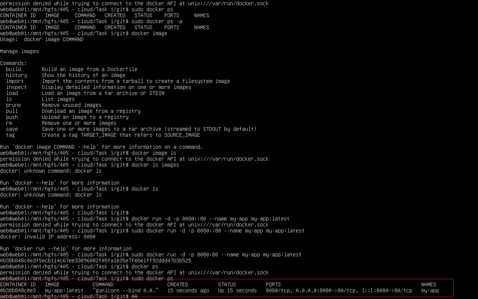

 
 

 

 

Task 1 — Foundation, Service Models, and First Deployment
Project: Sunbeam Electricity Distribution – Data and Cloud Platform Modernisation
Submission: End of Module 2
1. Architecture pack
1.1 Proposed architecture
The proposed architecture uses managed cloud services for ingestion, storage, processing and analytics. Sunbeam retains control of customer identity mapping, encryption keys, access policies and regulatory decisions within its Nigerian-controlled environment. It supports three decisions: monthly identification of feeders needing revenue protection; feeder outage alerting within fifteen minutes; and daily verification of estimated bills and review of disconnections.
Table 1: Workload inventory
Workload	Load pattern	Data sensitivity	Service model	Reason
Readings pipeline	Continuous; nightly batch	High	PaaS	Managed ingestion, storage and processing cut administration.
Analytics and loss prediction	Monthly	High	PaaS	No servers or ML infrastructure to maintain.
Identity mapping and encryption keys	Occasional, controlled	Very high	IaaS / controlled	Keeps re-identification assets in Nigeria.
Field revenue dashboard	Daily, mobile	High	PaaS	Managed hosting with secure mobile access.
Workforce identity and access	Continuous	High	SaaS	Central authentication, MFA and role-based access.
Billing review and disputes	Daily	Very high	PaaS	Auditable workflows with human approval.
Table 2: Shared responsibility – readings pipeline
Responsibility	Sunbeam's responsibility	Cloud provider's responsibility
Infrastructure	Select services, set capacity, approve architecture.	Operate data centres, servers and networking.
Security and access	Set encryption, access policies and classification; manage identities and MFA.	Provide encryption capabilities and platform security controls.
Data and recovery	Validate and reconcile readings; retention, monitoring, backups.	Storage availability, durability and managed services.
Regulatory compliance	Lawful processing, cross-border compliance, customer rights.	Contractual commitments, documentation, certifications.
Important: PaaS does not transfer data protection or compliance responsibility to the provider; Sunbeam remains accountable as data controller.
1.2 Responsible-use brief
Who could be harmed?	Where the system must refuse or escalate	Initial position
Unmetered customers	Estimates above NERC feeder caps are flagged for correction.	Estimates must be justified, transparent and capped.
Customers suspected of tampering	Analytics suspicion never triggers disconnection or penalties automatically.	Field investigation and authorised human review required.
Rural or low-income customers	Missing or delayed readings must not raise a feeder's risk score.	Check predictions for geographic and customer-group bias before use.
Ethical position: The platform supports investigation, not automated punishment. A model-generated suspicion is a lead, not evidence of wrongdoing, and customers must have review and appeal before any disconnection.
2. Architecture Decision Records (ADRs)
ADR-01: Service model for the readings pipeline
Status: Accepted. Decision: Adopt Platform as a Service (PaaS) for the meter readings pipeline.
Context: Sunbeam receives approximately 400,000 smart-meter readings across 1,000 feeders in its Standard production tier. Self-managing ingestion, storage and processing would overload a team of three engineers.
Options considered: IaaS (flexible, but Sunbeam must manage patching, scaling and availability); SaaS (limited control over specialised ingestion and reconciliation); PaaS (managed services with low operational overhead).
Rationale: PaaS best balances scalability, simplicity, security and cost, and supports fifteen-minute outage detection through managed streaming.
Consequences: Less administration and easier scaling, but dependence on provider availability and pricing; lock-in is mitigated by open data formats, documented interfaces and infrastructure-as-code.
ADR-02: Workload retained on infrastructure Sunbeam controls
Status: Accepted. Decision: Retain the customer identity mapping service and associated re-identification keys within Sunbeam-controlled infrastructure in Nigeria.
Context: The platform already replaces customer identities with codes before data reaches the South African lake; the mapping key stays on a server in Abeokuta.
Rationale: Keeps direct identification out of the analytical environment, preserves Sunbeam's control and supports data minimisation.
Security controls: Restricted, logged and reviewed access; encryption at rest and in transit; privileges separated from the analytics platform; encrypted backups with a documented recovery procedure.
Consequences: Sunbeam remains responsible for securing and recovering this workload, so it must stay deliberately small.
3. Regulatory and data protection considerations
NERC compliance: Apply approved feeder estimated-billing caps, keep evidence for estimates, record reviews and disputes, and ensure disconnections follow NERC procedures with human review and appeal.
Nigeria Data Protection Act 2023: Treat customer-linked readings as personal data; document the lawful basis for processing; run a DPIA for loss prediction and profiling; apply minimisation, encryption, access control and retention policies; and document safeguards for transfers to South Africa (Sections 41–43). Pseudonymisation does not make data anonymous.
Governance: The Data Protection Officer oversees privacy compliance, engineering implements the controls, and the legal basis for predictive analytics is documented and reviewed, not assumed.
4. Initial deployment approach
Deployment phases: (1) foundation: cloud accounts, networking, IAM, MFA; (2) data services: managed ingestion and encrypted data lake; (3) data protection: pseudonymisation, controlled identity mapping, audit logging; (4) initial pipeline: ingestion, reconciliation, quality validation; (5) monitoring of pipeline health, storage and failures.
Acceptance criteria: Readings are securely ingested; identities are hidden from general analytics users; quality checks catch duplicate, delayed and mis-mapped readings; access is auditable; and the three-person team can operate it.
5. Position to defend before the examiner
I will adopt a managed cloud-first approach because a team of three engineers needs operational simplicity, while keeping identity mapping and encryption keys in Nigeria. The platform will not make autonomous decisions affecting electricity supply: analytics guide field investigations, and billing disputes and disconnections stay under documented human review.

